<picture>
  <source media="(prefers-color-scheme: dark)" srcset="assets/header-dark.svg">
  
</picture>

 

I'm **Mahmoud**, a software engineer from Tunisia and a Master's student in Cybersecurity at **Université Internationale de Tunis (UIT)**. I'm currently a **cybersecurity intern at NoBreach**, working where software development and security meet.

I'm looking for a **research internship or a Master's thesis** in cybersecurity, as a pathway toward a **PhD**. I'm also open to **building web and mobile apps** for teams and businesses that need one.

<table>
  <tr>
    <td valign="top" width="50%">
      <b>Now</b>  
      Cybersecurity intern at NoBreach, since May 2026 
      Master's in Cybersecurity at UIT, since 2025 
      Co-organizer of Google Developer Groups Carthage
    </td>
    <td valign="top" width="50%">
      <b>Research interests</b>  
      Software security 
      Vulnerability discovery 
      Systems security 
      AI-assisted cybersecurity
    </td>
  </tr>
</table>

## Selected work

**Security and AI**

| Project | What it does | Built with |
| --- | --- | --- |
| [**FinCrime Graph**](https://github.com/MahmoudMans/fincrime) | An anti-money-laundering workspace that spots suspicious money movement, maps it as a graph and takes each case from the first alert to a sealed, auditable conclusion | Spring Boot, Neo4j, PostgreSQL, Next.js |
| **AI-based antivirus** | Analyzes the features of executable files and uses machine learning to identify malware | Python, scikit-learn, C++, Qt |
| **Legal Doc Analyzer** | Reads a contract and returns the clauses that matter, each quoted from the document, with an AI model that can run locally so the text does not have to leave the machine | Next.js, NestJS, Ollama |
| **Infra Sentinel** | Self-hosted monitoring for websites, APIs and servers that opens incidents, alerts the right person and publishes status pages | TypeScript, Next.js, NestJS, Go, PostgreSQL |

**Products and platforms**

| Project | What it does | Built with |
| --- | --- | --- |
| **TenderPilot** | Scores public tenders against a company's profile and walks a bid team from "is this worth it?" to a submitted bid | Spring Boot, OpenSearch, Ollama, Next.js |
| **ProcureIQ** | Follows a purchase from the first request to the delivered order, with its own portal for suppliers | Spring Boot, PostgreSQL, Next.js |
| **TerraScope** | Live earthquake, volcano, wildfire and storm monitoring, with alert rules and a Situation Room to run an incident | Spring Boot, PostgreSQL, Next.js, Leaflet |
| **VentureScope** | Financial planning for startups, from assumptions to a board pack, on a history that the database refuses to rewrite | Next.js, Prisma, PostgreSQL |
| **Economofar** | An iPhone app that turns shopping receipts into a daily budget, price tracking and twenty spending analyses | SwiftUI, Spring Boot, PostgreSQL |
| [**BuildFlow**](https://github.com/MahmoudMans/buildflow) | Project management for construction companies, with budgets, schedules, site reports and a client portal | Spring Boot, PostgreSQL, Next.js |

## Tech I work with

**Languages** 

**Frameworks** 

**Data and machine learning** 

**Infrastructure** 

## Certifications

| Certificate | Issuer | Year |
| --- | --- | --- |
| CCNA: Introduction to Networks | Cisco Networking Academy | 2026 |
| Professional Scrum Master I (PSM I) | Scrum.org | 2025 |
| AWS Certified Cloud Practitioner | Amazon Web Services | 2024 |
| Google Solution Challenge 2024 | Google | 2024 |
| TensorFlow Developer Certificate | Google | |

## Community

- **Co-organizer, Google Developer Groups Carthage** since January 2024: DevFest, Google I/O Extended and International Women's Day events
- **Local tech lead**, Tunis stop of the Daytona Developers Club Tour '24
- **Technical Activities Manager**, Metaverse Tunisian Summit 2.0, IEEE
- **Technical lead, then lead and mentor**, Google Developer Student Clubs SMU, from 2021

## Get in touch

If you have a research topic in cybersecurity, a thesis, or a web or mobile app to build, I would like to hear about it.

I speak Arabic, French and English.
